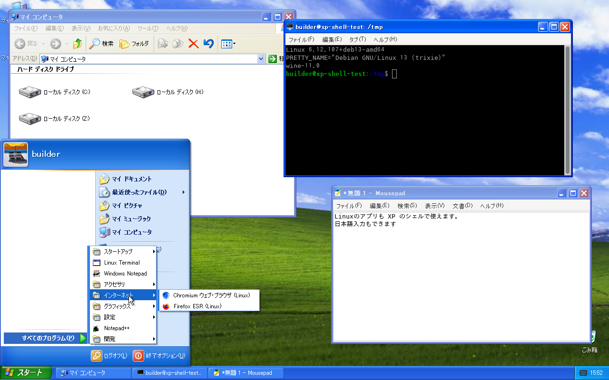

<p align="center">
  
</p>
<p align="center">
  <strong>Your Linux desktop, with the Windows XP shell.</strong>
</p>
<p align="center">
  <a href="../../LICENSE"></a>
  
  
  
</p>
<p align="center">
  <a href="../../README.md" title="日本語" aria-label="日本語">🇯🇵</a> ·
  <strong title="English" aria-label="English">🇬🇧</strong>
</p>

> [!IMPORTANT]
> **This is a personal, experimental project**, not a finished product for daily use.
> It has only been tested on a **freshly installed Debian 13** set up with the installation script.
> Installing it on a system already in use (with another desktop environment or display manager, for example) has not been tried.
> A virtual machine or a spare machine is recommended.

## Install

1. Get a Japanese Windows XP Professional SP3 (x86) ISO **yourself**.
2. On a freshly installed Debian 13, run as the user who will log in:

```sh
git clone https://github.com/mikuta0407/win4wine.git ~/win4wine
cd ~/win4wine
scripts/setup.sh --media /path/to/WindowsXPSP3.iso --greeter
```

3. Reboot. The XP Welcome screen logs you straight into the XP shell.

Details: 🔗 [installation guide (INSTALL.en.md)](INSTALL.en.md). Building Wine takes about 90 minutes on 4 cores.

## What it is

It runs Windows XP's own `explorer.exe` on a patched Wine as the **desktop shell of Linux**.
The taskbar, Start menu, desktop and folder windows are XP's real ones, and Linux applications get XP's frames and taskbar buttons.

No Microsoft files are included. Only the files that are needed are extracted locally from your own ISO.

## What it does

- **XP's shell**: Luna (or Classic) taskbar, Start menu, desktop, My Computer and folder windows.
- **Linux applications**: Linux windows get XP's frames; the taskbar, Alt+Tab, minimize and maximize work as on XP.
  Linux applications are listed under All Programs.
- **Notification area**: Linux tray icons (StatusNotifierItem and XEmbed) show up in XP's notification area.
- **Japanese input**: fcitx5 + Mozc, toggled with Ctrl+Space (or Zenkaku/Hankaku), in GTK, Qt and Wine applications.
- **Windows applications**: a WoW64 Wine 11.0 runs 32-bit and 64-bit programs. Run `wine setup.exe` in a terminal and
  the installer's shortcuts land in XP's Start menu.
- **XP Welcome screen**: an optional LightDM greeter that shows XP's Welcome and log-off screens.
- **XP's keys**: the Windows key, Ctrl+Esc, Win+R and Win+E.
- **Recovery**: if the XP shell keeps crashing, the session falls back to Wine's own explorer and an xterm.
- **Wayland session (optional, even more experimental than the X11 session)**: a patched labwc instead of the X11 WM,
  with a scale per monitor and scales such as 125% or 150%; the XP shell stays crisp, and Wayland applications get XP's
  frames too. It is new, tested less than the X11 session and has known limits ([docs/wayland.md](../../docs/wayland.md),
  Japanese). The X11 session is the one to try first.

## Caution

> [!WARNING]
> - **Obtain the Windows XP ISO yourself.** Neither this repository nor its scripts download any Microsoft files.
>   Follow Microsoft's license terms for the ISO and the files extracted from it.
> - **Use at your own risk.** The author is not responsible for data loss or any other problems.
> - This is an unofficial project, not affiliated with Microsoft or the Wine project.
> - Only the Japanese XP SP3 (x86) has been tested; the setup expects the Japanese fonts (MS Gothic).

## How it works

```text
LightDM ─ XP Welcome greeter (greeter/)
   └─ XP Shell session (session/supervisor.py)
        ├─ Wine 11.0 + 62 patches (wine/patches/)
        │    └─ XP's explorer.exe, shell32.dll, … (extracted from the ISO)
        ├─ bridge-wm: an X11 WM + Win32 proxy windows (bridge-wm/)
        │    (Wayland session: a patched labwc instead of the WM, wayland/)
        └─ fcitx5 + Mozc, tray bridge (bridge-wm/tray.py)
```

The design documents are in Japanese; [docs/README.md](../../docs/README.md) lists them.

## Similar projects

- [loss32](https://loss32.org/): a planned Linux distribution whose desktop is made only of Win32 software on Wine,
  with parts of ReactOS. While win4wine runs XP's own shell on Debian, loss32 is built from free software only.

## Ground rules

- Binaries from Windows are never modified; differences are handled in Wine and around it.
- Microsoft binaries are never disassembled. Behavior is studied through public APIs and our own probes on a real XP.
- Microsoft files, extracted files and prefixes live only in `localres/` and `.local/`, which Git ignores.

## License

[LGPL-2.1-or-later](../../LICENSE), the same as Wine. It covers only the code and patches in this repository,
except `wayland/patches/labwc/` (GPL-2.0-only, as labwc) and `wayland/patches/wlroots/` (MIT, as wlroots).
The Windows XP files, and the XP screens in the screenshot, are copyrighted by Microsoft.
